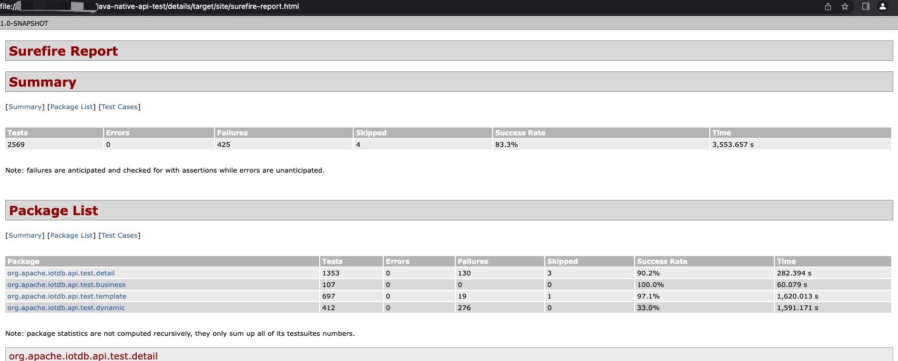
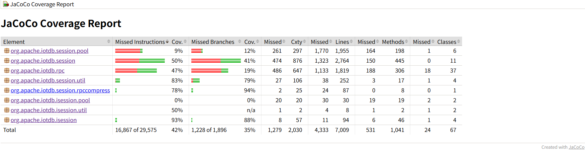

# Java Native API Test Cases

Apache IoTDB Java Native API 自动化测试工程，基于 Maven 与 TestNG 组织测试用例。

## 项目结构

```text
.
├── assets/                         # README 图片资源
├── code/                           # 覆盖率分析源码目录
│   ├── classes/                    # 存放class 文件
│   ├── src/                        # 存放java文件
├── common/                         # 公共模块
│   ├── src/main/java/              # 公共测试基类、工具类
│   ├── src/main/resources/         # 包括连接配置文件、TestNG 配置、CSV 测试数据
│   └── src/test/resources/         # 测试日志配置
├── details/                        # 具体测试用例模块
│   ├── src/main/resources/         # 主测试套件 testng.xml
│   └── src/test/java/              # 具体测试用例
├── jacoco/                         # JaCoCo agent、CLI 与覆盖率报告目录
├── run_coverage.bat                # Windows 覆盖率执行脚本
├── run_coverage.sh                 # Linux/macOS 覆盖率执行脚本
├── pom.xml                         # Maven 父工程
└── README.md                       # 项目说明
```

## 环境要求

| 组件 | 要求 |
| --- | --- |
| JDK | 17+ |
| Maven | 3.9.8+ |
| IoTDB | 与 `pom.xml` 中 `iotdb.version` 保持一致 |

> 说明：项目源码编译目标为 Java 17，构建与测试请使用 JDK 17+。

## 配置说明

### 1. IoTDB 连接配置文件

位于 `common/src/main/resources/config.properties`。

### 2. IoTDB 依赖版本

IoTDB Java 客户端依赖版本统一在根目录 `pom.xml` 中维护。手工切换测试目标版本时，修改 `iotdb.version`，并确保本地或远程 Maven 仓库中存在对应依赖。

PLM 执行时不需要手工改 `pom.xml`：产品源码构建脚本会把本轮 TimechoDB 源码版本写入仓库根的 `.plm-dep-version`（未跟踪文件），`start.sh` 读取后用 `-Diotdb.version=<值>` 覆盖根 pom 的声明，并在文件更新时强制重新编译。该文件由 PLM 管理，**不要提交到仓库**；手工本地运行时可删除它回退到 pom 版本。

### 3. TestNG 用例范围

测试套件文件位于 `details/src/main/resources/testng.xml`，可通过增删 `<class>` 节点调整执行的测试范围。

## 功能测试

1. 启动待测 IoTDB 实例。
2. 修改 `common/src/main/resources/config.properties`，确保连接配置正确。
3. 执行 Maven 构建：

```bash
mvn clean package -DskipTests
```

4. 执行测试并生成报告：

```bash
mvn surefire-report:report
```

测试报告输出路径：`details/target/site/surefire-report.html`



## PLM 接入（start.sh）

仓库根目录的 `start.sh` 是 TimechoPLM 测试程序统一入口，不改变原有 Maven 用法：

```bash
sh start.sh prepare                 # 编译测试程序（mvn install -DskipTests）
sh start.sh list-cases --json       # 用例清单（stdout 仅 JSON）
sh start.sh case <CASE_ID>          # 单条用例，产物写 $PLM_REPORT_DIR
```

- `PLM_AUTOMATION_TYPE`：PLM 绑定的仓库类型（默认 `session-java`）。
- `PLM_REPORT_DIR`：JUnit XML 输出目录（相对仓库根，默认 `reports/`）。真实 run 中，执行机上 `reports/plm-exec` 下超过 2 天的逐用例目录会按年龄回收（产物已由 PLM 下载归档）。
- `PLM_RUN_ID`：PLM 真实执行时注入的 run 标识。同一个 run 内，同一个 TestNG 类的**可缓存结果只真正执行一次**，其余用例从 `reports/plm-class-cache/<runId>/...` 复用结果（键包含 FQCN、HEAD、工作区改动、构建标记、DB 地址与依赖版本；可用 `PLM_CLASS_CACHE_DIR` 改缓存根，默认仓库内 `reports/plm-class-cache`）。`PLM_CLASS_CACHE=0` 可关闭复用；只有 operationKey 为 `run:<id>` 的真实执行会注入，sync/check 等非 run 操作不注入（任何创建 `test_run` 的执行都会带 `run:` 前缀并注入）。配置失败、类超时、目标方法不在报告里时不会复用坏结果：前两者会让后续同类用例重跑/复用超时结论，目标缺失会作废缓存重跑。
- `PLM_CLASS_TIMEOUT_SEC`：单个测试类的硬超时（默认 600 秒），依赖 coreutils `timeout`；缺失时 `start.sh` 会在 stderr 告警并退化为无硬超时。客户端对服务端 socket 读没有超时，服务端卡住时用 `timeout` 终止整类，并写出带原因的 ERROR；同一 run 内后续同类用例复用该超时结论，下个 run 重新尝试，避免挂住 PLM 整轮。
- `.plm-known-issues.json`：已知产品限制/待确认行为的用例清单，**必须随仓库提交到执行机**。`match`（错误消息正则）把匹配的 failure/error 改写成带原因的 SKIPPED；**没有 `match` 的条目只用于“目标方法 0 次执行”的停用用例**（如空 DataProvider），不会吞掉真实运行出来的失败；`skipRun=true` 直接跳过会挂起的用例（如 `TestDynamicTemplateMin` 的 aligned tablet 写入）。清单只做“可见的已知问题”，不要用来掩盖普通失败。
- **清理策略**：PLM run 的首个测试类做一次全库/全模板清理并写 `reports/plm-run-state/<runId>/cluster-cleaned`；后续类只按 `managedDatabases()` / `managedTemplates()` / `managed*Prefixes()` 删自己的资源。`TestDataBase` 这种需要干净实例的类用 `requiresGlobalClean()` 仍会触发一次全量清理。手工运行（无 `PLM_RUN_ID`）保持旧的“每个类全库清理”行为。新增测试类请在类里声明自己拥有的库/模板，不要再在 `@BeforeClass` 里调用 `cleanDatabases`/`cleanTemplates`；`reports/plm-run-state` 与 `reports/plm-exec` 一样按 2 天年龄回收。
- `IOTDB_HOST` / `IOTDB_PORT`：PLM 执行时由平台按 `k8sInstanceId` 解析 K8s 实例的 `connectionHost/connectionPort` 后注入，测试程序必须使用该地址；缺少任一项时 `start.sh case` 直接失败，**不会回退到 `config.properties` 的默认地址**。手工本地运行时可不设置，继续使用 `config.properties`。
- `IOTDB_USER` / `IOTDB_PASSWORD` / `IOTDB_IS_CLUSTER` / `IOTDB_HOST_NODES`：可选覆盖；PLM 不注入数据库账号/口令，账号/口令由本仓库 `config.properties` 的 `user/password` 提供（默认 `root/TimechoDB@2021`，开源版可改为 `root/root`）。
- 执行机依赖：本地 Maven 仓库需有 `iotdb.version`（当前 `2.0.11-SNAPSHOT`）对应的 `com.timecho.iotdb:session-parent`、`com.timecho.iotdb:isession-parent`、`com.timecho.iotdb:service-rpc`、`org.apache.iotdb:iotdb-jdbc`；由 TimechoDB 2.0.11 源码执行 `mvn -DskipTests -pl iotdb-client/service-rpc,iotdb-client/isession,iotdb-client/session,iotdb-client/jdbc -am install` 安装。旧版本若仍使用 `org.apache.iotdb:iotdb-session` / `isession` 坐标，需同步调整根 `pom.xml` 的依赖管理。手工运行且没有 `.plm-dep-version` 时，切换目标数据库版本需同步修改根 `pom.xml` 的 `iotdb.version`；PLM 构建会自动覆盖，不需要改 pom。
- `.plm-dep-version`：PLM 产品源码构建写入的依赖版本覆盖文件（未跟踪，勿提交）。存在时 `start.sh` 用 `-Diotdb.version=<值>` 覆盖根 `pom.xml` 的 `iotdb.version`，文件比 `details/target/.plm-build-ok` 新时强制重编；手工运行时可删除该文件回退到 pom 版本。
- 导入用例后由 `.plm-case-id-map.json` 维护 PLM 编号与 TestNG 目标（`FQCN::method`）的映射；同时支持扁平 `{自然ID: PLM编号}` 与 `{nmap, revmap}` 两种格式。
- 导入脚本：`python3 scripts/plm/import_to_plm.py --product-id <id> --feature-id <id>`（PAT 只从环境变量读取；`--dry-run` 可先预览）。
- 结果后处理单测：`python3 -m unittest discover -s scripts/plm -p 'test_*.py'`。

原有 `mvn clean package -DskipTests` 与 `mvn surefire-report:report` 流程不受影响。

## 覆盖率测试

覆盖率测试通过 JaCoCo 采集 IoTDB 相关类的执行覆盖率。

如覆盖率验证前需要启动本地 IoTDB，可在以下目录执行 `start-standalone.bat`：

```bash
D:\iotdb-test\iotdb\distribution\target\apache-iotdb-2.0.7-SNAPSHOT-all-bin\apache-iotdb-2.0.7-SNAPSHOT-all-bin\sbin\windows\start-standalone.bat
```

若该目录不存在，先在 `D:\iotdb-test\iotdb` 下执行以下命令打包生成 distribution：

```bash
mvn clean package -DskipTests -am -pl distribution
```
 
1. 将 `common/src/main/resources/config.properties` 中的 `is_coverage` 设置为 `true`。
2. 准备覆盖率所需源码文件：
   `code/src/`：放置待分析源码
3. 执行脚本：

Windows

```bash
run_coverage.bat
```

Linux/macOS

```bash
./run_coverage.sh
```

覆盖率报告输出路径：`jacoco/report/index.html`



> 注意：功能测试请保持 `is_coverage=false`，仅在覆盖率测试时改为 `true`。

## 常见问题

- 依赖下载失败：当前项目依赖 `2.0.7-SNAPSHOT`，请确认网络可访问对应 Maven 仓库，或提前将依赖安装到本地仓库。
- IoTDB 连接失败：确认 IoTDB 已启动，并检查 `host`、`port`、`url`、`user`、`password` 配置是否正确。
- CSV 解析或数据驱动异常：功能测试请不要开启 `is_coverage`，并确认测试数据文件位于 `common/src/main/resources/data`。
